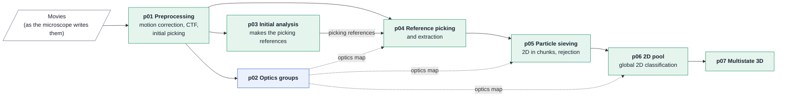
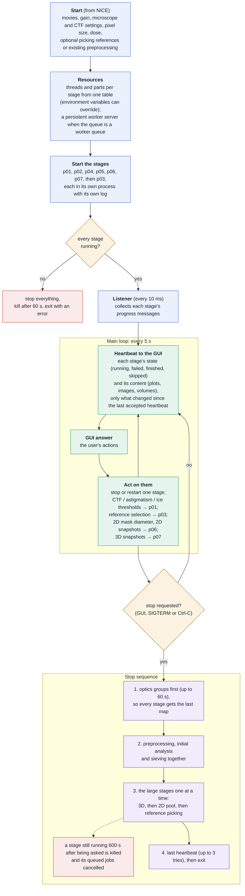

# Stream master (p00) at a glance

How the master runs a streaming session, for readers who know the technique but not the code. The
master does no image processing: it starts the seven processing stages as separate processes,
passes their progress to the GUI (NICE), and passes the user's actions back to them. The stages
hand data to each other through folders, not through the master. Contract and details:
`ipc_policy.md` and `restart_policy.md`; this page summarises the code.

## The pipeline the master starts

All seven start at once; each waits for its upstream folder to fill. Preprocessing is skipped
when the user points at an existing preprocessing folder, and the initial analysis when the user
supplies picking references.

## What the master does

## Worth knowing

- **The master never ends on its own.** A session ends only when the user stops it (or the
  process gets SIGTERM / Ctrl-C). When every stage has finished, the master keeps sending
  heartbeats until then.
- **A stage that dies is not restarted automatically.** It shows as failed and the whole stream as
  "error"; the user can restart it from the GUI, and the stage restores what it can from its folder.
- **Only changes are sent.** The heartbeat carries only content that changed; if the GUI does not
  accept one, the next sends everything again.
- **Reference picking stops last**, after sieving, so it can keep picking while the rest stops.
- **A stage killed at the 600 s limit shows as failed**, which makes the session's final status
  "failed" even if everything else finished.
- **NICE marks a stream failed after a minute without a heartbeat**, which is why the last
  heartbeat is retried.
