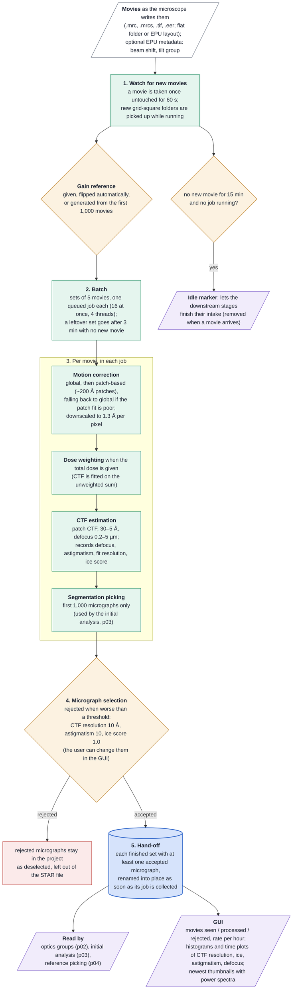

# Stream preprocessing (p01) at a glance

How the stream preprocesses movies as they arrive, for readers who know the technique but not the
code. p01 watches the microscope's movie folder, motion-corrects and CTF-estimates every new movie
in batches, picks the first ~1,000 micrographs by segmentation, rejects micrographs that fail the
quality thresholds, and hands finished batches to the later stages. This page summarises the code;
the restart rules are in `restart_policy.md`.

## Worth knowing

- **Nothing is processed until the gain is settled**: with a generated gain, that means waiting for
  the first 1,000 movies.
- **Rejection is one-way and applies from now on.** A threshold changed in the GUI applies to later
  batches; loosening it does not bring back micrographs already rejected, and batches already handed
  on are not revised. The thresholds survive a restart.
- **Astigmatism is relative** (|dfx − dfy| / mean defocus) while its default threshold is 10, so it
  very likely never rejects anything; worth checking.
- **A CTF fit worse than 30 Å is recorded at the threshold** and therefore accepted.
- **A failed job's movies count as rejected** and are not retried in the same run.
- **Two movies with the same file name in different folders**: the second is ignored.
- **An existing preprocessing folder can replace p01** entirely (the master's `dir_preprocess`).
