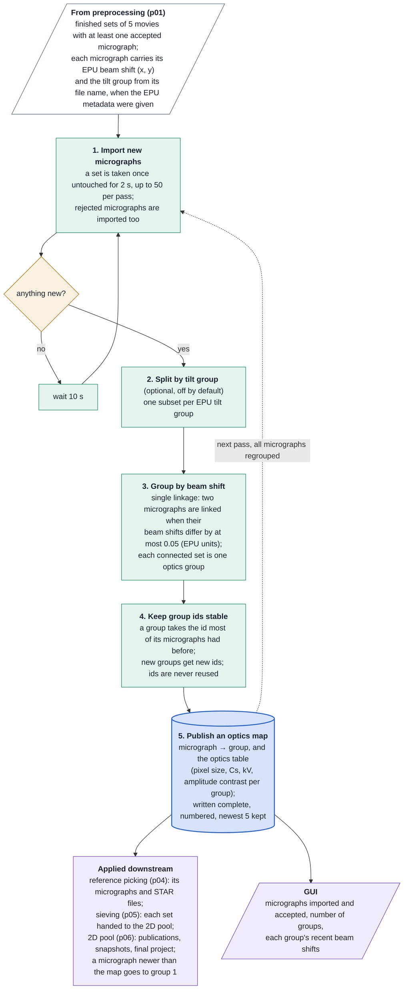

# Stream optics groups (p02) at a glance

How the stream assigns optics groups, for readers who know the technique but not the code. p02
groups micrographs recorded with similar beam-image shift (and, if asked, the same EPU tilt
group), and publishes a map from micrograph to group that the downstream stages apply to their
micrographs and particles. This page summarises the code; the restart rules
are in `restart_policy.md`.

## Worth knowing

- **Optics groups are bookkeeping and export.** They end up as `rlnOpticsGroup` in the STAR files;
  no SIMPLE alignment or reconstruction uses them.
- **Without the EPU metadata every beam shift is 0**, so there is a single group.
- **Single linkage chains:** two shift clusters joined by a path of micrographs, each step within
  the threshold, become one group, and rejected micrographs can be the bridge. Within a session
  groups can only grow or merge, so merged groups leave gaps in the ids.
- **"Beam tilt" means the EPU tilt group** taken from the file name (`Data_…`), not a measured
  beam tilt; it is off by default.
- **All micrographs are regrouped on every pass** that imports something; the ids stay stable.
- **On a stop, p02 is stopped first** (up to 60 s) so every other stage gets the last map. After a
  restart it publishes nothing until every micrograph of its last map is back, so readers never
  apply a partial map.
