# Stream initial analysis (p03) at a glance

How the stream makes its picking references, for readers who know the technique but not the code.
p03 picks the first preprocessed micrographs by segmentation, classifies the particles in 2D, by
default builds a multistate ab initio 3D model, and publishes one stack of picking references for
reference-based picking (p04). Then it stops. It is skipped when the user supplies picking
references. Contract and details: `reference_generation_policy.md`; this page summarises the code.

```mermaid
flowchart TD
    IN[/"<b>From preprocessing (p01)</b><br/>preprocessed micrographs, with p01's segmentation<br/>of the first 1,000 micrographs"/]

    subgraph C1 ["Cycle 1: the first 100 micrographs"]
        direction TB
        W1{"more than 100 micrographs,<br/>or preprocessing quiet?"}
        PICK["<b>Segmentation picking</b><br/>particle diameters binned (20–500 Å);<br/>bins near the median kept (within 3 MAD);<br/>box = 1.0–1.5 × the largest diameter"]
        NOBOX["no usable size: wait for<br/>100 more micrographs"]
        X1["<b>Extract</b> the particles"]
        D1["<b>2D classification</b><br/>~100 particles per class (10–100 classes), to 8 Å"]
        S1["<b>Class selection</b><br/>quality model, then a size-compatibility filter"]
        MSK["<b>Mask diameter</b> estimated from the<br/>selected class averages (automask, widened 1.2×)"]
        W1 -->|yes| PICK
        PICK -->|size found| X1 --> D1 --> S1 --> MSK
        PICK -->|none| NOBOX -.-> W1
    end

    subgraph ALL ["The 'all' set: up to 500 micrographs"]
        direction TB
        PA["<b>Pick and extract</b> every micrograph again<br/>with cycle 1's sizes and box"]
        SV["<b>Particle sieve</b> (coarse pass)<br/>chunks of ~5,000 particles: 2D (100 classes, to 15 Å)<br/>and rejection of junk classes with their particles"]
        PA --> SV
    end

    subgraph C2 ["Cycle 2: references from 3D"]
        direction TB
        D2["<b>2D classification</b> of the sieved particles<br/>with the estimated mask"]
        S2["<b>Class selection</b> as in cycle 1"]
        BAL["<b>Balance the classes</b><br/>class averages repeated in proportion to population,<br/>up to 501 rows, to weight the 3D"]
        AB["<b>Ab initio multistate 3D</b> from the class averages<br/>3 states, 100 → 20 Å then to 8 Å, c1;<br/>repeated up to 3 times if it collapses to one state"]
        CH{"<b>Choose one state</b><br/>one connected object (≥ 80% of the density),<br/>≥ 10% of the population, resolution within 1.5× of the best;<br/>then most distinct views"}
        RP["<b>Reproject</b> the chosen state<br/>50 directions, rescaled to the particle pixel size"]
        D2 --> S2 --> BAL --> AB --> CH --> RP
        CH -.->|none passes: best by views, with a warning| RP
    end

    GUISEL{"<b>User selects references in the GUI</b><br/>class averages of cycle 1 or 2,<br/>at any time before publication"}
    PUB[("<b>Publish the picking references</b><br/>written complete, then renamed into place;<br/>final: never replaced")]
    P04[/"<b>Reference picking (p04)</b><br/>clusters them into 10 templates (12 rotations, mirrors)<br/>and measures the mask diameter again"/]
    GUI[/"<b>GUI</b><br/>picking and analysis status, micrograph thumbnails with picks,<br/>selected class averages, the chosen volume and its reprojections,<br/>the published references"/]

    IN --> W1
    MSK --> PA
    SV --> D2
    RP --> PUB
    GUISEL ==>|first to publish wins| PUB
    PUB --> P04
    PUB --> GUI

    classDef step fill:#e5f5ee,stroke:#1b8a5f,color:#1c2230
    classDef check fill:#fcf2e1,stroke:#b46e0c,color:#1c2230
    classDef fail fill:#fbeaea,stroke:#b93a34,color:#1c2230
    classDef ref fill:#d6e3fb,stroke:#2c64c9,stroke-width:2px,color:#1c2230
    classDef out fill:#f1ecfb,stroke:#6b46c1,color:#1c2230
    classDef input fill:#ffffff,stroke:#5a6374,color:#1c2230
    class PICK,X1,D1,S1,MSK,PA,SV,D2,S2,BAL,AB,RP step
    class W1,CH,GUISEL check
    class NOBOX fail
    class PUB ref
    class P04,GUI out
    class IN input
```

## Worth knowing

- **Three routes, one result.** References given at the start skip p03 entirely; otherwise either
  the user's GUI selection of class averages or the 3D route publishes first, and the first to
  publish wins. A selection made in the same pass as a finishing 3D run wins.
- **By default the references are 50 c1 reprojections of one state** of a 3-state ab initio model;
  p04 reduces them to 10 templates. None of the settings has been tuned by a validation run.
- **The particle box comes from cycle 1's ~100 micrographs** and is fixed for the session; so is
  the mask estimate. p03 passes no mask diameter downstream: p04 measures it again from the
  published references.
- **"Population" in the state choice counts balanced class-average rows**, not particles.
- **Cycle-2 particles are sieved first** (coarse pass only), so cycle 2 sees cleaner particles than
  cycle 1.
- **Failures stop p03** (extraction, either 2D, the 3D, the reprojection); it stays stopped until
  the user restarts it. A restart after publication just sends the references again; before
  publication it runs the whole plan again.
