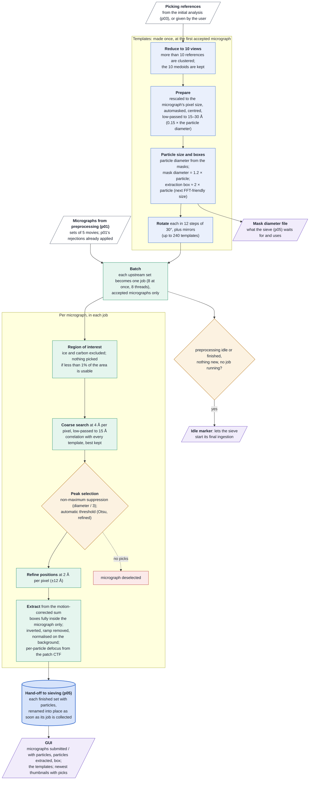

# Stream reference picking (p04) at a glance

How the stream picks and extracts particles, for readers who know the technique but not the code.
p04 turns the picking references into templates once, picks every accepted micrograph by template
matching, extracts the particles, and hands them batch by batch to particle sieving (p05).
Contract and details: `reference_generation_policy.md` (p04's use of the references); this page
summarises the code.

## Worth knowing

- **At most 10 views become templates**, and they are made once, at the first micrograph's pixel
  size; nothing remakes them later. The initial analysis's 3D route publishes 50 reprojections,
  which are clustered down to 10.
- **The particle size comes from the references**, not from the user: a given particle diameter is
  ignored, and the mask diameter p04 measures is the one the sieve uses.
- **The extraction box is about twice the particle** and is not raised to a minimum; particles whose
  box crosses the micrograph edge are lost.
- **The picking low-pass is fixed at 15 Å**: the `lp_pick` setting currently has no effect.
- **A failed job is not retried**; its micrographs are only counted in the log.
- **p04 applies no micrograph thresholds of its own**, and a threshold the user changes in p01 later
  does not reach sets p04 has already taken.
