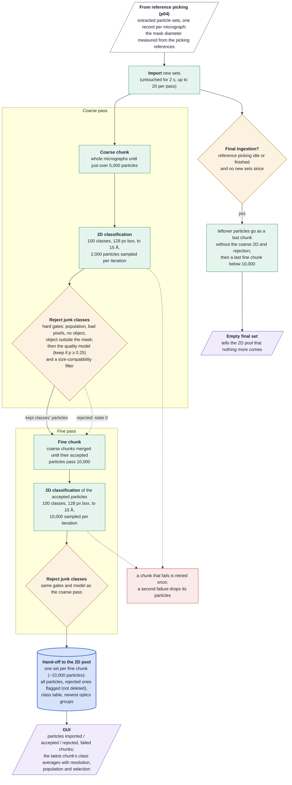

# Stream particle sieving (p05) at a glance

How the stream removes junk particles continuously, for readers who know the technique but not the
code. p05 groups the particles from reference picking into chunks, classifies each chunk in 2D,
rejects bad class averages together with their particles, and does this twice (a coarse pass,
then a fine pass on merged chunks) before handing clean sets to the 2D pool (p06). Contract and
details: `doc/policies/sieving_and_rejection/ptcl_sieve_policy.md`; this page summarises the code.

Up to 4 chunk jobs run at once (16 threads each), fine chunks first; each 2D has a 29-minute
limit. The stage checks for new sets and finished chunks every 10 s.

## Worth knowing

- **Most particles are classified twice** (in chunks of ~5,000, then ≥ 10,000), but only the fine
  pass is handed on. The leftovers of the final ingestion skip the coarse pass by design.
- **The 2D is deliberately coarse:** a 128-pixel box, 15 Å (coarse) and 10 Å (fine).
- **Rejected particles are flagged, not deleted**, in the hand-offs; the 2D pool only uses the
  accepted ones.
- **The final set waits for reference picking to go idle**, which in turn waits until no new movie
  has arrived for 15 minutes.
- **"Accepted" and "rejected" in the GUI** count only finished fine chunks (and coarse chunks that
  came out empty).
- **A chunk that fails twice drops its particles**; only the GUI's failed-chunk count shows it.
- **The `sieve` quality model still needs a validation run** since it was refitted for the mask
  diameter.
