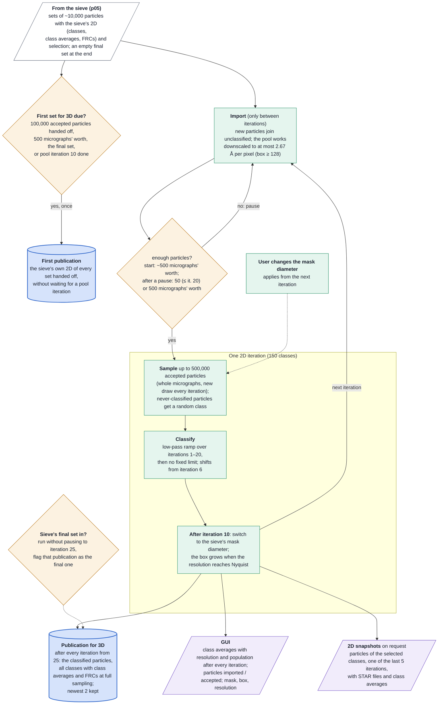

# Stream 2D pool (p06) at a glance

How the stream classifies all its particles in 2D, for readers who know the technique but not the
code. p06 keeps one growing pool of every particle the sieve accepts and classifies it one 2D
iteration at a time, shows the class averages in the GUI, writes snapshots of the classes the user
selects, and publishes classified particles for multistate 3D (p07). Contract and details:
`pool2D_policy.md` and `stream_3D_ingestion_policy.md` (sections 2, 3 and 9); this page
summarises the code.

## Worth knowing

- **The pool rejects nothing.** It classifies the particles the sieve accepted; class selection for
  3D happens in p07.
- **Above 500,000 particles each iteration uses a random subset** of about 500,000 (whole
  micrographs, a new draw every iteration); particles outside the sample keep their classes.
- **The first set for 3D comes from the sieve, not the pool**, and in practice appears about when
  the pool starts (both wait for roughly 500 micrographs' worth of particles). It is tried once; if
  it cannot be built, the pool publishes instead after iteration 10 or once 100,000 particles are
  classified.
- **Iterations 11 to 24 publish nothing**, so 3D sees a settled classification.
- **The pool pauses between imports**: it waits for more particles before the next iteration, and
  the sieve's final set lifts the pause until iteration 25, and past 25 until the final
  publication has been made.
- **Late particles never see the coarse low-pass limits**, which end at iteration 20.
- **A failed iteration is retried once**; a second failure stops the stage.
