# Stream multistate 3D (p07) at a glance

How the streaming pipeline turns 2D-classified particles into several 3D states, for readers who
know the technique but not the code. Reference volumes are built once from class averages; after
that, every new batch of particles is sorted into those states by matching class averages against
the references, and the particles' poses are refined locally. The contract, with every rule and
constant, is `stream_3D_ingestion_policy.md` (sections 4, 9 and 10); this page is a summary of it.

```mermaid
flowchart TD
    IN["<b>Input from the 2D pool (p06)</b><br/>First set: the sieve's own 2D classification of the first<br/>~100,000 accepted particles (or 500 micrographs, the last data, pool iteration 10)<br/>Later: the pool's classified particles after every 2D iteration from 25<br/>(when busy, p07 skips ahead to the newest)"]

    subgraph A ["A. Build the reference volumes: once, on the first set"]
        direction TB
        A1["<b>1. 2D classification</b><br/>first set into 150 classes"]
        A2["<b>2. Class selection</b><br/>quality model keeps good class averages;<br/>particles of rejected classes dropped for the session"]
        A3["<b>3. Split classes into sub-classes</b><br/>~500 sub-class averages in total, with even/odd halves"]
        A4["<b>4. Ab initio multi-state 3D from class averages</b><br/>up to 3 states; low-pass 20 → 12 Å;<br/>angular window narrowed in later stages"]
        A5{"<b>5. Check the volumes</b><br/>halves in one state agree on orientations:<br/>median ≤ 50°<br/>and on states ≥ 70%<br/>states distinct: correlation ≤ 0.97 at 15 Å<br/>after docking (both hands)<br/>≥ 2 states with ≥ 5% of the averages"}
        AF["<b>Failed</b><br/>run 1–5 again (2 attempts in all),<br/>then ab initio on the next publication's class averages,<br/>still failing: keep the attempt whose halves agree best (warning)"]
        REF[("<b>Reference volumes</b><br/>states that hold class averages;<br/>fixed for the session, reused on restart")]
        A1 --> A2 --> A3 --> A4 --> A5
        A5 -->|pass| REF
        A5 -->|fail| AF
        AF -.->|retry| A1
        AF -.->|best attempt| REF
    end

    subgraph B ["B. Assign each publication to the states: every publication"]
        direction TB
        B1["<b>1. Take in the new particles</b><br/>new micrographs appended; known particles get the latest 2D labels;<br/>quality model scores the classes for the log only"]
        B2["<b>2. Split classes into sub-classes</b><br/>~500 sub-class averages<br/>(if it fails: the pool's class averages are used)"]
        B3["<b>3. Match sub-class averages to the references</b><br/>each reference reprojected over 1,000 directions on the whole sphere<br/>(~6° apart; mirrors included); all at 15 Å;<br/>full in-plane rotation and shift search<br/>→ best state, 3D pose, correlation, margin over the next-best state"]
        B4{"<b>4. Reject poor fits, flag ambiguous ones</b><br/>correlation below median − 3×MAD: rejected<br/>(worst first, ≤ 30%); margin under 0.02: ambiguous"}
        OUTQ["rejected sub-classes' particles sit out<br/>until the next publication, then are judged again"]
        B5["<b>5. Particles inherit state and pose</b><br/>sub-class state; pose = sub-class pose<br/>combined with the particle's 2D in-plane alignment"]
        B6["<b>6. Local pose refinement, states fixed</b><br/>one iteration of continuous refinement (≤ 10° rotation, small shifts)<br/>against each particle's own state;<br/>gold-standard reconstruction of every state"]
        B1 --> B2 --> B3 --> B4
        B4 -->|kept, incl. ambiguous| B5 --> B6
        B4 -->|rejected| OUTQ
    end

    OUT[/"<b>What the user sees</b><br/>a volume per state with FSC, resolution, population<br/>and orientation distribution, after every publication;<br/>3D snapshots of chosen states on request"/]

    IN -->|first set| A1
    IN -->|later publications| B1
    REF ==>|matched against| B3
    REF -.->|shown at once, no resolution| OUT
    B6 --> OUT
    B6 -.->|next publication| B1

    classDef once fill:#eaf0fc,stroke:#2c64c9,color:#1c2230
    classDef pub fill:#e5f5ee,stroke:#1b8a5f,color:#1c2230
    classDef check fill:#fcf2e1,stroke:#b46e0c,color:#1c2230
    classDef fail fill:#fbeaea,stroke:#b93a34,color:#1c2230
    classDef ref fill:#d6e3fb,stroke:#2c64c9,stroke-width:2px,color:#1c2230
    classDef out fill:#f1ecfb,stroke:#6b46c1,color:#1c2230
    classDef input fill:#ffffff,stroke:#5a6374,color:#1c2230
    class A1,A2,A3,A4 once
    class B1,B2,B3,B5,B6 pub
    class A5,B4 check
    class AF,OUTQ fail
    class REF ref
    class OUT out
    class IN input
```

## Design choices

- **Fixed references.** Every publication is matched against the same volumes. Particle
  reconstructions never feed back into them, so the states cannot drift or collapse over the
  session.
- **A particle follows its sub-class.** Particles are re-assigned with every publication. If a
  particle's class changes, or its sub-class matches another state, its state changes too.
- **Refinement does not accumulate.** Each publication starts again from the poses of the matched
  sub-classes; the local refinement only polishes them. A particle more than about 10° off, or in
  the wrong state, is not corrected by it.
- **Why sub-classes.** 2D classes group particles mainly by view. Splitting them separates
  particles of different states that happen to look alike, and the references were built from
  sub-class averages too, so like is matched with like.
- **Why 15 Å and a full sphere.** Matching every state at one coarse limit stops sharper or
  smoother volumes from winning by resolution alone. Covering the whole sphere handles mirrored
  class averages without a separate mirror search.
- **Thresholds are provisional.** 50°, 70%, 0.97, 5%, 15 Å, 3×MAD, 30% and 0.02 are first guesses,
  to be set from a validation run on a known heterogeneous data set.
